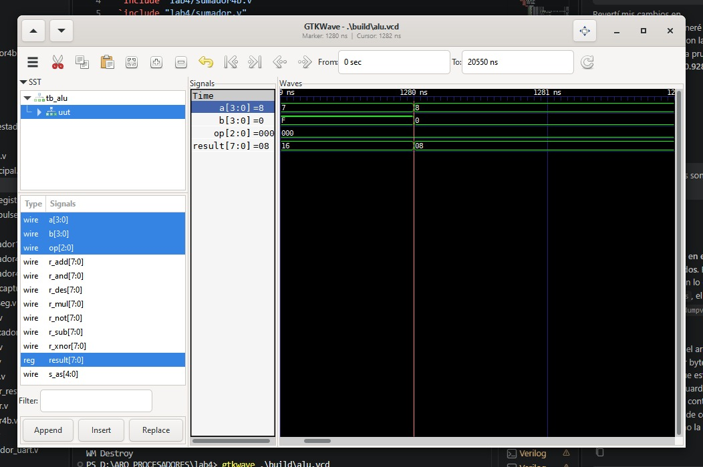
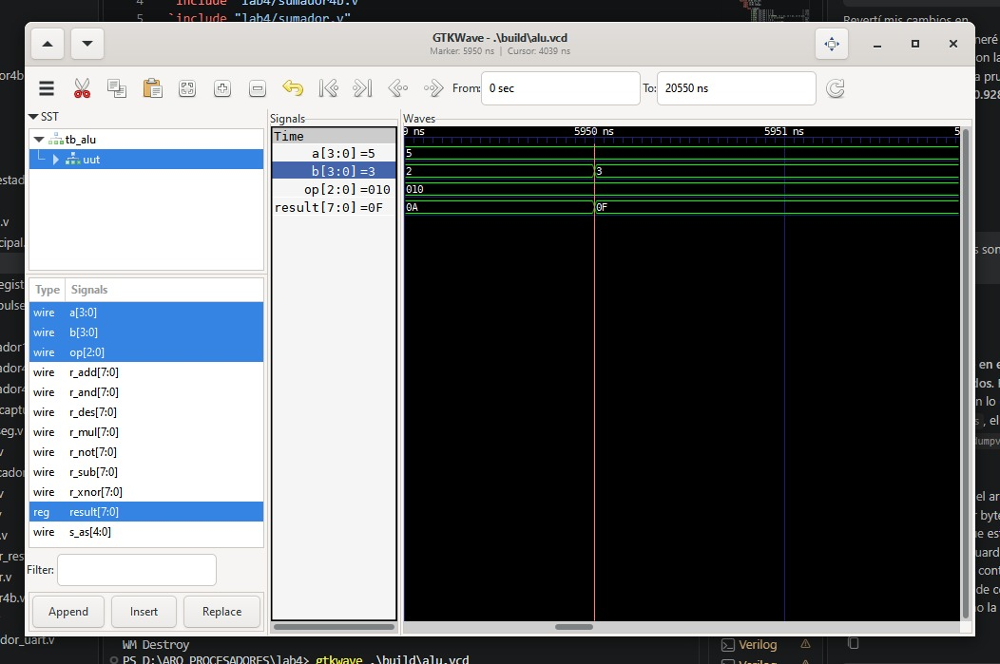
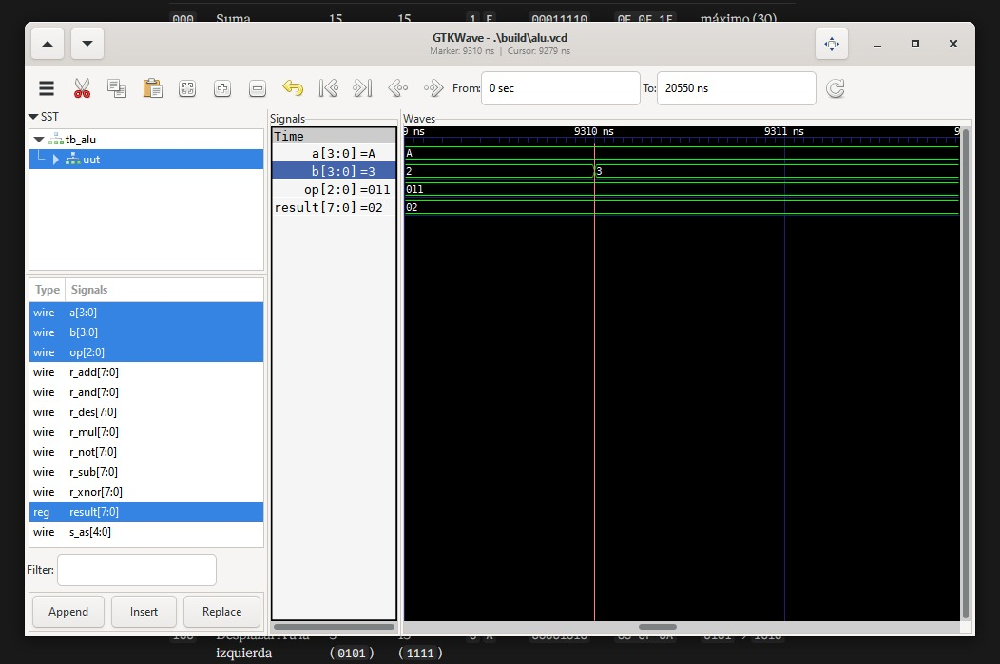
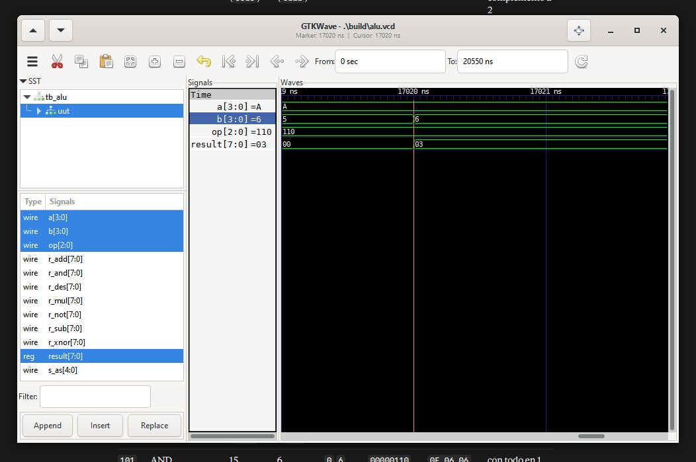
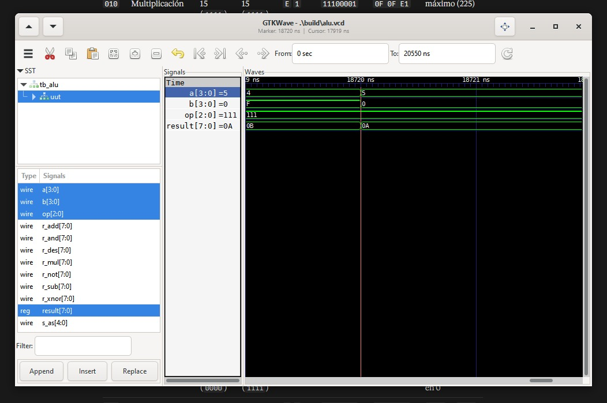
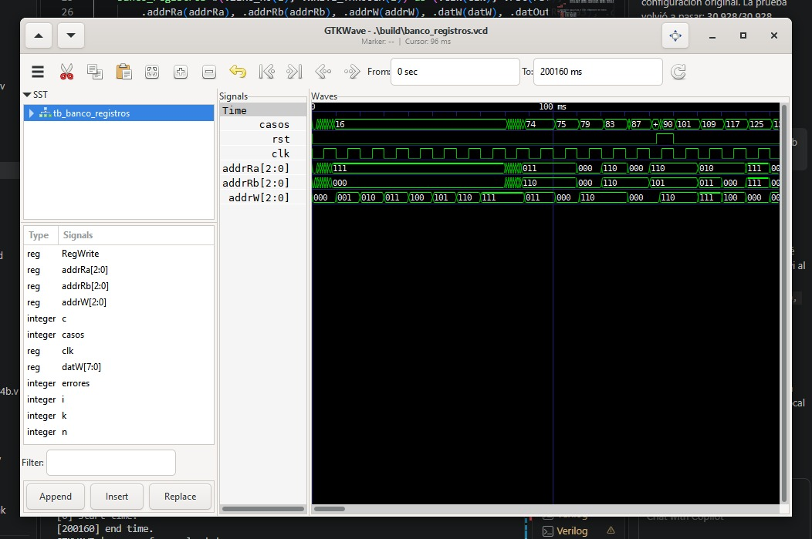
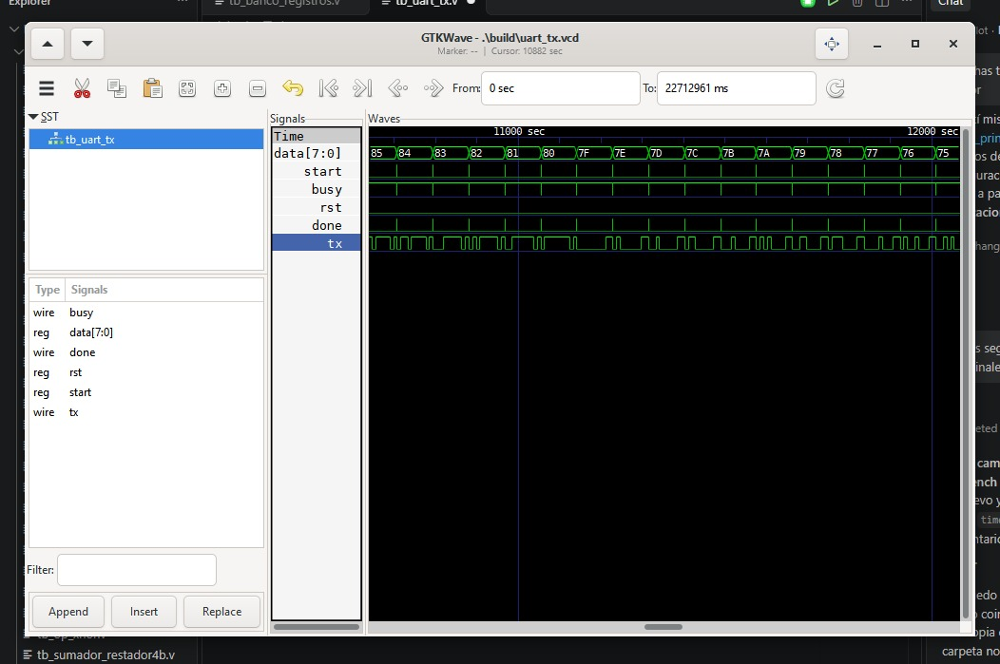

# Lab04: ALU, banco registro y UART.

# Integrantes
* [Paula Andrea Cortés](https://github.com/Cortes271) 
* [Santiago Leonardo Molina Bogotá](https://github.com/SaintGao-cmd)
* [Andrés Felipe Muñoz Martinez](https://github.com/Andresfmm2007) 
* [Laura Ximena Rojas Pachon](https://github.com/LauXRS) 

# Informe

Índice:

1. [Documentación del diseño implementado](#documentación-del-diseño-implementado)
2. [Simulaciones](#simulaciones)
3. [Evidencias de implementación](#evidencias-de-implementación)
4. [Preguntas](#preguntas)
5. [Conclusiones](#conclusiones)
6. [Referencias](#referencias)

## Documentación del diseño implementado

### 1. [Módulo ALU]

#### 1.1 Descripción
El módulo alu es el bloque principal encargado de seleccionar y ejecutar las operaciones disponibles sobre los operandos de entrada a y b.

Los operandos tienen un ancho de 4 bits y la salida tiene 8 bits. La operación que se ejecuta se selecciona mediante la entrada op, de 3 bits, permitiendo seleccionar ocho operaciones diferentes.
| `OP` | Operación |
|---|---|
| `000` | Suma |
| `001` | Resta |
| `010` | Multiplicación |
| `011` | Comparación |
| `100` | Desplazamiento a la izquierda |
| `101` | AND |
| `110` | XNOR |
| `111` | NOT |
#### 1.2 Funcionamiento
La ALU utiliza diferentes módulos para realizar cada operación y posteriormente selecciona el resultado correspondiente mediante la señal op

```verilog
[always @(*) begin
    case (op)
        3'b000: result = r_add;
        3'b001: result = r_sub;
        3'b010: result = r_mul;
        3'b011: result = r_cmp;
        3'b100: result = r_shift;
        3'b101: result = r_and;
        3'b110: result = r_xnor;
        3'b111: result = r_not;
        default: result = 8'b0;
    endcase
end]
```


#### 1.5 Tabla de Verdad

| `op` | A | B | 	Operación | Interpretación |
|---|---|---|---|---|
| `000` | 5 | 3 | `Suma` | 5 + 3 = 8 |
| `001` | 5 | 3 | `Resta` | 5 − 3 = 2 |
| `010` | 5 | 3 | `Multiplicación` | 5 × 3 = 15 |
| `011` | 5 | 3 | `Comparación` | `A > B` → `{0, 1, 0}` |
| `100` | 5 | 3 | `Desplazamiento` | `0101` → `1010` |
| `101` | 5 | 3 | `AND` | `0101 & 0011 = 0001` |
| `110` | 5 | 3 | `XNOR` | `~(0101 ^ 0011) = 1001` |
| `111` | 5 | 3 | `NOT` | `~0101 = 1010` |


### 2. [Módulo sumador_restador4b]

### 2.1 Descripción
Suma o resta dos números de 4 bits según la señal `sub`. La resta se hace con la técnica de **complemento a 2**: `A − B = A + (~B) + 1`.
 
### 2.2 Declaración del Módulo y Puertos
```verilog
module sumador_restador4b (
    input  wire [3:0] A,
    input  wire [3:0] B,
    input  wire       sub,    // 0 = suma, 1 = resta
    output wire [4:0] R       // {Co, S}
);
```
 
### 2.3 Cables Internos
```verilog
    wire [3:0] B_x = B ^ {4{sub}};        // invierte B solo en resta
```
- `B_x`: copia de `B` que se invierte bit a bit solo cuando `sub = 1`.
### 2.4 Lógica
```verilog
    wire [3:0] B_x = B ^ {4{sub}};        // invierte B solo en resta
    assign R = {1'b0, A} + {1'b0, B_x} + {4'b0, sub};
```

| A | B | `sub` | `R` = `{Co, S}` | Interpretación |
|---|---|---|---|---|
| 5 | 3 | 0 | `0_1000` | 5 + 3 = 8 |
| 15 | 15 | 0 | `1_1110` | 15 + 15 = 30 |
| 9 | 5 | 1 | `1_0100` | 9 − 5 = 4, `Co = 1` (A ≥ B) |
| 5 | 9 | 1 | `0_1100` | 5 − 9 = −4 (`1100` en complemento a 2), `Co = 0` |
| 3 | 5 | 1 | `0_1110` | 3 − 5 = −2 (`1110`), `Co = 0` |
| 0 | 0 | 1 | `1_0000` | 0 − 0 = 0, `Co = 1` |

### 3. [multiplicador4b]

#### 3.1 Descripción
Multiplicador combinacional de 4×4 bits tipo **suma de productos parciales** (*shift and add* desplegado en hardware). Usa tres sumadores `sumador4b` en cascada. A su vez, `sumador4b` se construye con cuatro `sumador` (sumador completo a nivel de compuertas) conectados en **acarreo propagado** (*ripple carry*).

#### 3.2 Funcionamiento
```verilog
module sumador4b(
    input  [3:0] A,
    input  [3:0] B,
    input        Ci,       // Acarreo de entrada inicial
    output [4:0] R_suma   // ÚNICA SALIDA: [Co, S] agrupados en 5 bits
);
    // Cables internos para propagar el acarreo entre etapas
    wire c1, c2, c3;
 
    // Cables internos para capturar temporalmente las salidas individuales
    wire [3:0] S;
    wire       Co;
 
    // Bit 0 (menos significativo): usa el acarreo de entrada Ci
    sumador b0 (
        .A  (A[0]),
        .B  (B[0]),
        .Ci (Ci),
        .S  (S[0]),
        .Co (c1)
    );
```
```verilog
    // Bit 3 (más significativo): genera el acarreo de salida final
    sumador b3 (
        .A  (A[3]),
        .B  (B[3]),
        .Ci (c3),
        .S  (S[3]),
        .Co (Co)
    );
 
    // Concatenación directa hacia el puerto de salida de 5 bits
    assign R_suma = {Co, S};
```
Cada bit de B controla un producto parcial.
Posteriormente estos productos parciales se suman y forman el resultado final.
### 3.3 Limitaciones
- El acarreo de entrada `Ci` de las tres etapas está fijo en 0.
- Es solo para números **sin signo**.
- La cadena de acarreo en serie hace que el retardo crezca con el número de etapas.
- Ocupa 16 compuertas AND y 12 sumadores completos

### 4. [Banco de registro]
#### 4.1 Descripción
El módulo está compuesto por un banco de 8 registros de 8 bits, que permite almacenar y consultar diferentes datos. Cuenta con un puerto de escritura sincronizado con el reloj y dos puertos de lectura.
En este proyecto, el sistema guarda:
- A en el registro R0.
- B en el registro R1.
- El resultado en R2.
Estos registros son utilizados posteriormente por el módulo UART para enviar y mostrar la información.

#### 4.2 Funcionamiento
```verilog
    always @(posedge clk) r0 <= rst ? 8'b0 : (we0 ? datW : r0);
    always @(posedge clk) r1 <= rst ? 8'b0 : (we1 ? datW : r1);
    always @(posedge clk) r2 <= rst ? 8'b0 : (we2 ? datW : r2);
    always @(posedge clk) r3 <= rst ? 8'b0 : (we3 ? datW : r3);
    always @(posedge clk) r4 <= rst ? 8'b0 : (we4 ? datW : r4);
    always @(posedge clk) r5 <= rst ? 8'b0 : (we5 ? datW : r5);
    always @(posedge clk) r6 <= rst ? 8'b0 : (we6 ? datW : r6);
    always @(posedge clk) r7 <= rst ? 8'b0 : (we7 ? datW : r7);
```
```verilog
    // Lectura combinacional (multiplexores de 8 entradas)
    wire [7:0] rawA = (addrRa == 3'd0) ? r0 :
                      (addrRa == 3'd1) ? r1 :
                      (addrRa == 3'd2) ? r2 :
                      (addrRa == 3'd3) ? r3 :
                      (addrRa == 3'd4) ? r4 :
                      (addrRa == 3'd5) ? r5 :
                      (addrRa == 3'd6) ? r6 : r7;
 
    wire [7:0] rawB = (addrRb == 3'd0) ? r0 :
                      (addrRb == 3'd1) ? r1 :
                      (addrRb == 3'd2) ? r2 :
                      (addrRb == 3'd3) ? r3 :
                      (addrRb == 3'd4) ? r4 :
                      (addrRb == 3'd5) ? r5 :
                      (addrRb == 3'd6) ? r6 : r7;
```
```verilog
    // r0 = 0 opcional y forwarding opcional (desactivado durante el reset)
    wire zeroA = (ZERO_R0 != 0) & (addrRa == 3'd0);
    wire zeroB = (ZERO_R0 != 0) & (addrRb == 3'd0);
    wire fwdA  = (WRITE_THROUGH != 0) & RegWrite & ~rst & (addrRa == addrW);
    wire fwdB  = (WRITE_THROUGH != 0) & RegWrite & ~rst & (addrRb == addrW);
 
    assign datOutRa = zeroA ? 8'b0 : (fwdA ? datW : rawA);
    assign datOutRb = zeroB ? 8'b0 : (fwdB ? datW : rawB);
```
Este código define las reglas de cómo funcionan los registros por dentro. Al encenderse, se asegura de que todos empiecen en cero para evitar errores. A la hora de guardar, usa un selector para abrir un solo registros a la vez y obedece al reloj siguiendo un orden estricto: primero revisa si hay una orden de borrar todo (reset), luego si debe guardar un dato nuevo, y si no, simplemente deja intacto lo que ya estaba, la lectura es instantánea y no depende del reloj.

### 4. [Módulo top `alu_principal`
#### 4.1 Descripción
Es el módulo de nivel superior para la FPGA. Integra el botón con antirrebote, la FSM de captura, la ALU, el banco de registros, el visualizador UART, el transmisor y los displays de 7 segmentos.
 
#### 4.2 Funcionamiento
```verilog
    // ---------------- Reset y disparo ----------------
    wire rst = ~KEY[0];
    wire start_pulse;
 
    button_pulse u_btn (
        .clk   (reloj_principal),
        .rst   (rst),
        .btn   (~KEY[1]),
        .pulse (start_pulse)
    );
```
```verilog
    // ---------------- Indicadores ----------------
    assign LEDR = {2'b00, alu_result};
 
    // Resultado (8 bits -> 2 displays)
    decod7seg u_hex0 (.d(alu_result[3:0]), .seg(HEX0));
    decod7seg u_hex1 (.d(alu_result[7:4]), .seg(HEX1));
 
    // B (2 displays)
    decod7seg u_hex2 (.d(b_q),             .seg(HEX2));
    decod7seg u_hex3 (.d(4'h0),            .seg(HEX3));
 
    // A (2 displays)
    decod7seg u_hex4 (.d(a_q),             .seg(HEX4));
    decod7seg u_hex5 (.d(4'h0),            .seg(HEX5));
```
1. Botones (rst y btn): Las señales de los botones se invierten debido a que trabajan con lógica activa en bajo, de modo que el sistema interpreta un 1 como botón presionado.

2. Filtro antirrebote (button_pulse): Estabiliza la señal del botón durante aproximadamente 10 ms para evitar activaciones falsas y generar un único pulso válido por cada pulsación.

3. Control de captura (control_captura): Coordina el proceso mediante una máquina de estados (FSM). Al detectar una pulsación válida, captura los datos de entrada y la operación seleccionada, y controla su almacenamiento en memoria.

4. Unidad aritmética y lógica (alu): Realiza la operación seleccionada utilizando los valores capturados previamente, evitando que los cambios en los interruptores modifiquen el resultado antes de una nueva pulsación.

5. Banco de registros (banco_registros): Almacena los operandos y el resultado de la operación en posiciones específicas de memoria: R0, R1 y R2, respectivamente.

6. Transmisión UART (visualizador_uart y uart_tx): Lee los datos almacenados y los envía mediante comunicación serial para visualizar los valores y resultados en el computador.

Resumen del funcionamiento:

El sistema inicia con la detección de una pulsación, cuya señal pasa por un filtro antirrebote. Posteriormente, la FSM captura los valores de entrada y la operación seleccionada, y los envía a la ALU para realizar el cálculo. Los operandos y el resultado se almacenan en el banco de registros y, finalmente, el módulo UART se encarga de leer y transmitir la información al computador. De esta manera, los datos y resultados de la placa se actualizan únicamente cuando se realiza una nueva captura mediante el botón.
### 4. Diagramas


*Figura 1. [Diagrama esquemático RTL de descripción de hardware dado por Quartus.]*


*Figura 2. [Evidencia de la suma en la FPGA.]*


*Figura 3. [Evidencia de la resta en la FPGA.]*


*Figura 4. [Enlace del PuTTY.]*


*Figura 4. [Envio masivo de la UART.]*

## Simulaciones

### 1. Simulación de la [ALU]

| Suma | Resta |
|---|---|
|  |  |

| Multiplicación | Comparación |
|---|---|
|  |  |

| Desplazamiento a la izquierda | AND |
|---|---|
|  |  |

| XNOR | NOT A |
|---|---|
|  |  |

### 2. Simulación del [banco de registros]


*Figura 2. Simulación del banco de registros.*

### 3. Simulación de [UART]


*Figura 3. Simulación de las señales `data`, `start`, `busy`, `rst`, `done` y `tx` del transmisor UART.*

## Conclusiones

- La implementación de la ALU permitió integrar diferentes operaciones aritméticas y lógicas dentro de un mismo sistema digital.
- La utilización de módulos independientes para cada operación permitió mantener una estructura modular y facilitar la comprobación individual de cada bloque.
- El banco de registros permitió almacenar los operandos y resultados de las operaciones, proporcionando una estructura organizada para el manejo de los datos.
- El control de captura permitió establecer una secuencia ordenada para almacenar el operando A, el operando B y finalmente el resultado de la ALU.
- La comunicación UART permitió enviar la información almacenada en el sistema hacia un dispositivo externo utilizando comunicación serial.
- La conversión de los datos a formato ASCII facilita la visualización de la información enviada por UART en un computador.
- La integración de la ALU, el banco de registros y la UART permitió comprobar el funcionamiento conjunto de diferentes bloques de arquitectura digital.
- La estructura modular del proyecto facilita futuras modificaciones, como agregar nuevas operaciones a la ALU, ampliar el banco de registros o modificar el formato de comunicación UART.

## Referencias

- [Autor. Título. Año. URL.]
- [Autor. Título. Año. URL.]
